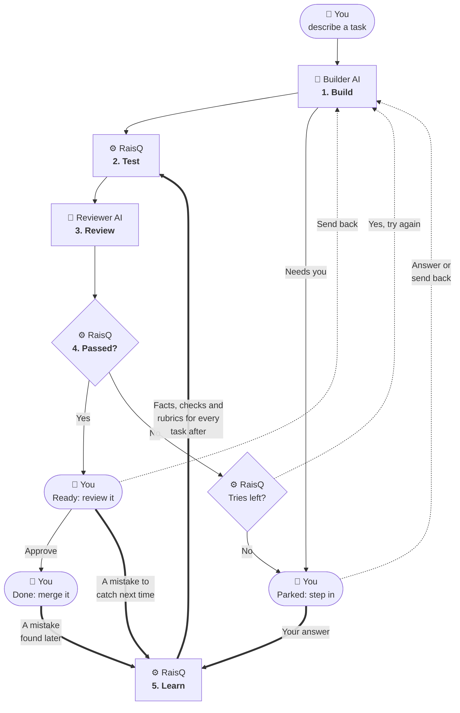

# RaisQ

## How it works

Four actors take part:

- 🧑 **You** say what you want and make the final call.
- 🤖 **Builder AI**, the AI coding agent you use, writes the code.
- 🤖 **Reviewer AI**, a separate AI session with no tools, checks the builder's work.
- ⚙️ **RaisQ** runs everything in between, and decides pass or fail with plain code.

1. **Build.** 🤖 The builder AI writes the code. If it needs you, for example with a question, the task is parked.
2. **Test.** ⚙️ RaisQ runs your project's tests as they were before the builder started, so the builder can't pass by editing them.
3. **Review.** 🤖 The reviewer AI checks that each requirement is met and that each fact, like a price or a phone number, matches what 🧑 you told RaisQ. It must quote what it found.
4. **Passed?** ⚙️ RaisQ decides, with plain code. If the work failed and there are tries left, the 🤖 builder AI tries again, told exactly what was wrong.
5. **Learn.** ⚙️ RaisQ keeps what 🧑 you teach it, so every later task is judged by it. Your answer to a question becomes a fact, so it isn't asked again. A mistake you send back, or find after merging, becomes a new check or rubric, once you approve it. A lesson that turns out wrong is retired. The thick arrows show this.

Every task ends **ready** or **parked**, and either way it's 🧑 your turn:

- **Ready** means it passed everything. Read the result, then approve it, or send it back with a note.
- **Parked** means it needs you: the builder AI asked a question or needs access it doesn't have, or it ran out of tries. Answer it, or make the task clearer and send it back.

Whatever you answer or send back goes into the task, and it's built again. Once you approve it, it's done, and the work is on its own git branch for you to merge.
