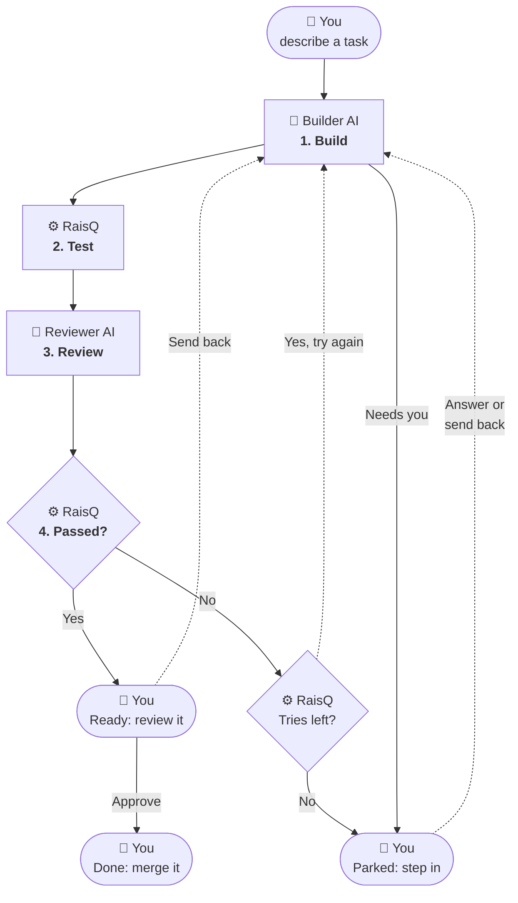

# RaisQ

**Let an AI agent code for you, and only read the results that are worth your time.**

You give RaisQ a task. An AI coding agent builds it, and RaisQ checks the work before you ever see it. If the work is wrong, the agent is told exactly what to fix and tries again. You only review work that has already passed.

Say it like *rescue*.

## The problem it solves

AI agents are fast, but you can't trust them unwatched. An agent trying to finish a task might:

- edit a failing test so it passes, instead of fixing the code
- make up a phone number, a price or an opening time
- leave placeholder text that looks finished

If you have to check every line it writes, you haven't saved much time. RaisQ does that checking for you.

## How it works

Four actors take part:

- 🧑 **You** say what you want and make the final call.
- 🤖 **Builder AI**, the AI coding agent you use, writes the code.
- 🤖 **Reviewer AI**, a separate AI session with no tools, checks the builder's work.
- ⚙️ **RaisQ** runs everything in between, and decides pass or fail with plain code.



1. **Build.** 🤖 The builder AI writes the code in a sealed-off container that ⚙️ RaisQ sets up, away from the rest of your computer. If it needs you, for example with a question, the task is parked.
2. **Test.** ⚙️ RaisQ runs your project's tests as they were before the agent started, so the builder can't pass by editing them.
3. **Review.** 🤖 The reviewer AI checks that each requirement is met and that each fact, like a price or a phone number, matches what 🧑 you told RaisQ. It must quote what it found.
4. **Passed?** ⚙️ RaisQ decides, with plain code. If the work failed and there are tries left (3 by default), the 🤖 builder AI tries again, told exactly what was wrong.

Every task ends **ready** or **parked**, and either way it's 🧑 your turn:

- **Ready** means it passed everything. Read the result, then approve it, or send it back with a note.
- **Parked** means it needs you: the builder AI asked a question or needs access it doesn't have, or it ran out of tries. Answer it, or make the task clearer and send it back. [Why a task gets parked](docs/guides/tasks.md#why-a-task-gets-parked).

Whatever you answer or send back goes into the task, and it's built again. Once you approve it, it's done, and the work is on its own git branch for you to merge.

## Principles

RaisQ is built on a few ideas. They're why you can trust what it hands you.

- **Nothing grades its own work.** A separate AI session reviews the builder's result without being able to change it, and plain code, not an AI, makes the final pass or fail call.
- **Show the evidence.** The reviewer must quote the exact words it's judging, and RaisQ checks those words are really there. A verdict without evidence isn't a verdict.
- **You decide what's true.** Facts about your project come from you. Anything the AI guessed is marked as a guess, and anything nobody knows is kept out instead of made up.
- **Safe by design, not by settings.** The builder works in a container with only a copy of your project. It can't see your SSH keys or logins, can't change the tests that judge it, and can't push, merge or deploy. None of that needs configuring. [How isolation works](docs/reference/how-it-works.md#isolation).
- **Your time is for decisions.** RaisQ handles retries and routine checks, and brings you only what needs a person: what it wasn't sure about, and the choices the agent made on its own.
- **It gets stricter over time.** When a mistake slips through, you can turn it into a new check, so it's caught on every task after.
- **Use the tools you have.** RaisQ works with any AI agent and any test runner. Each one is a small plugin file, so nothing is locked to one vendor.

## Get started

RaisQ runs on macOS and Linux. You need [git](https://git-scm.com), [Docker](https://www.docker.com/get-started/), and an AI coding agent with a command-line tool, logged in. RaisQ works with any agent; [Claude Code](https://docs.anthropic.com/en/docs/claude-code) and [Cursor](https://cursor.com/cli) are the ones tested so far, and [any other can be added](docs/reference/plugins.md#builder).

**1. Install RaisQ:**

```
curl -fsSL https://raw.githubusercontent.com/kkurno/raisq/main/install.sh | sh
```

The installer puts `raisq` in a folder that's already on your `PATH`, so it works straight away. Run it again to update. To install with Go instead, see [installing](docs/guides/getting-started.md#1-install-raisq).

**2. Set up RaisQ in your project's folder:**

```
raisq init
```

It finds your agent and container tool.

**3. Teach RaisQ how your project is checked,** from your agent's chat (with Claude Code, run `raisq skill claude-code` first):

```
/raisq set up this project
```

Your agent reads your CI, scripts and docs, and proposes checks, rubrics and facts. RaisQ tries each check on your project before it's added, and nothing is added until you agree. Commit the `.raisq/` folder: it's how your project's work is judged, shared with your team. Your own settings and tasks stay in `.raisq/local/`, which git ignores.

### Your first task

Every task takes the same three steps: describe it, let it work, review it.

```
raisq task "Add a contact page"          # describe it; RaisQ asks about anything unclear
raisq run                                # the builder AI builds it, and RaisQ checks it
raisq review add-a-contact-page          # read what was done and what it wasn't sure about
raisq review add-a-contact-page --done   # approve it
```

The work is on its own git branch, `raisq/add-a-contact-page`. Merge it like any other branch. RaisQ never merges or deploys anything itself.

### Or just ask your agent

You can take the same steps from your AI agent's chat. Type `/raisq`, then say what you want done and to which task, in your own words. Each request matches one command:

```
/raisq add a contact page              → raisq task "Add a contact page"
/raisq run the contact page            → raisq run add-a-contact-page
/raisq show me the contact page        → raisq review add-a-contact-page
/raisq approve the contact page        → raisq review add-a-contact-page --done
```

Your agent runs the command and tells you what happened. When a request could mean two things, it asks rather than guesses, and it checks with you before approving anything. It never answers RaisQ's questions for you. [More on using RaisQ from chat](docs/guides/chat.md).

The [getting started guide](docs/guides/getting-started.md) walks through all of this with a real example.

## Run tasks while you're away

`raisq run` builds one task while you watch. Queue several, and `raisq batch` builds them all, one after another, while you're away:

```
raisq task "Add a contact page"
raisq task "Fix the menu on mobile"
raisq batch
```

A batch never waits for you: a task that needs you is parked, and the next one starts. It stops cleanly at its time limit (8 hours by default) or your AI account's usage limit. When you're back, a report lists what's ready and what needs you. [More on batches](docs/guides/batch.md).

## Learn more

| I want to… | Read |
|---|---|
| Try it step by step, with an example | [Getting started](docs/guides/getting-started.md) |
| Write, run and review tasks | [Working with tasks](docs/guides/tasks.md) |
| Use RaisQ by chatting with my agent | [Using RaisQ from chat](docs/guides/chat.md) |
| Queue several tasks and walk away | [Batches](docs/guides/batch.md) |
| Tell RaisQ the facts about my project | [Facts](docs/guides/facts.md) |
| Fix something that isn't working | [Troubleshooting](docs/guides/troubleshooting.md) |
| Use a different AI, tool or test runner | [Plugins](docs/reference/plugins.md) |
| See every setting | [Configuration](docs/reference/configuration.md) |
| Understand exactly how a result is judged | [How it works](docs/reference/how-it-works.md) |

## Contributing

Bug reports, plugins and doc fixes are welcome. See [CONTRIBUTING.md](CONTRIBUTING.md), and [SECURITY.md](SECURITY.md) to report a security issue.

## License

[MIT](LICENSE)
